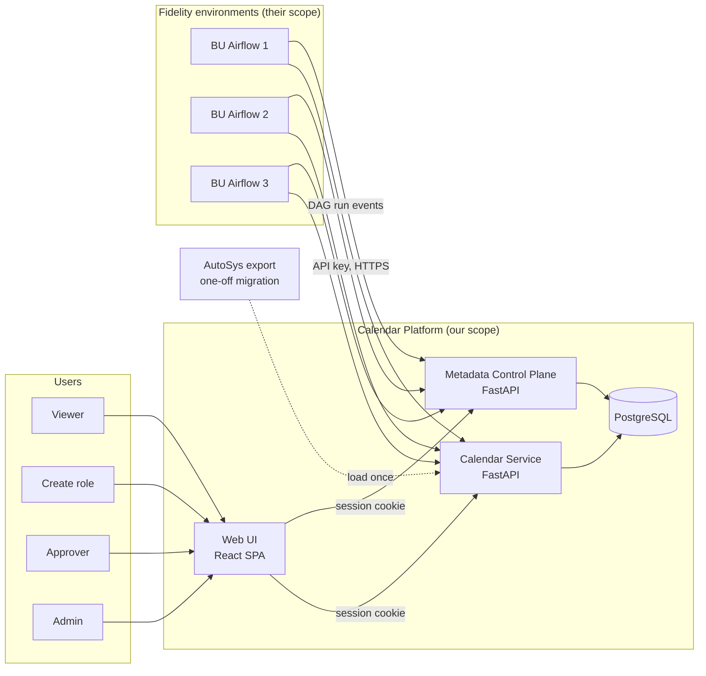
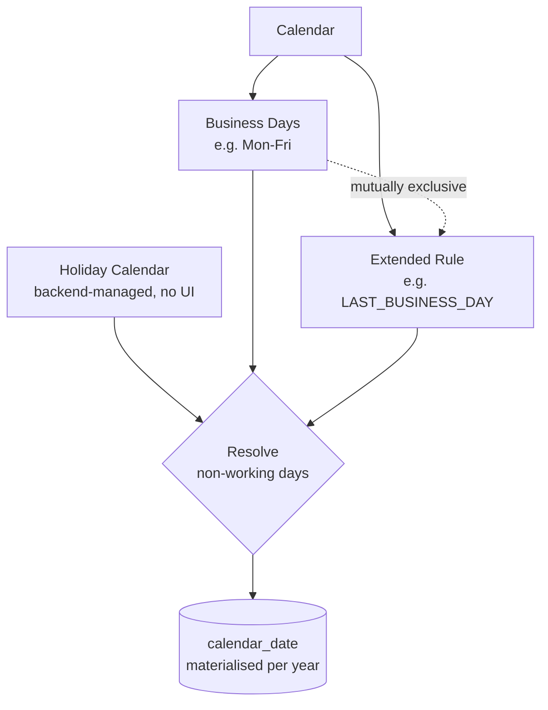
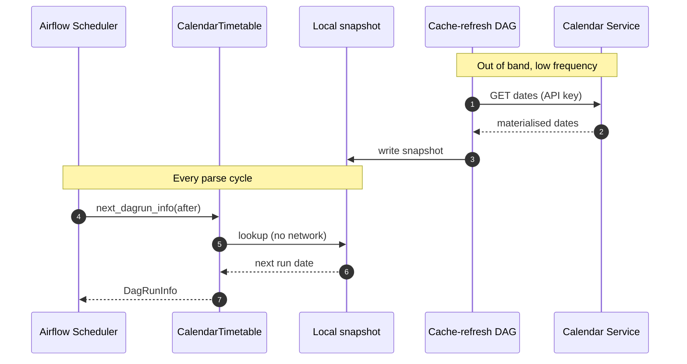
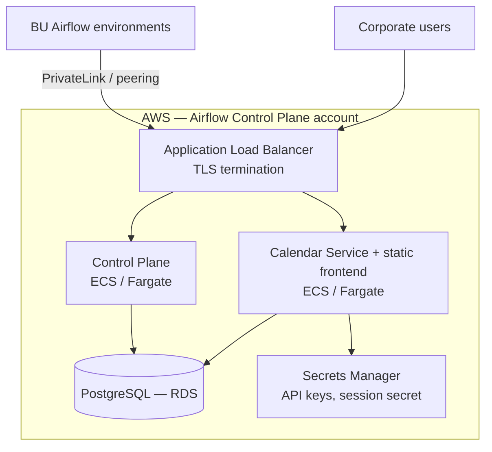

# High Level Design

**Airflow Enterprise Calendar Service and Metadata Control Plane**

| | |
|---|---|
| Version | 0.1 (draft for client review) |
| Date | 2026-10-12 |
| Status | Calendar Service partially built; plugin and control plane blocked |
| Companion documents | [RECORD.md](../../RECORD.md) decisions · [TRACKER.md](../../TRACKER.md) progress · [lld.md](lld.md) detail · [user-flows.md](user-flows.md) journeys |

> **How to read this document.** Anything marked **Built** exists and is covered by automated
> tests. **Planned** is agreed but not written. **Blocked** needs a client decision first — the
> blocking question is named inline so it can be answered directly.

---

## 1. Purpose

AutoSys currently decides *when* enterprise jobs run. As scheduling moves to Apache Airflow, that
decision needs a new home. This platform provides it:

1. A **Calendar Service** that is the single authority for which dates a job should run on.
2. An **Airflow plugin** that lets a DAG follow a named calendar without embedding the logic.
3. A **Metadata Control Plane** giving a central view of DAG runs across Business Units.

The business outcome is that a scheduling change — a new holiday, a revised month-end rule — is a
calendar edit made by an authorised user, not a code change to dozens of DAGs.

---

## 2. System context



**Boundary note.** We deliver the plugin as a package; Fidelity installs it, wires it into DAGs
and operates it (D-07). The dotted AutoSys path runs once during migration.

---

## 3. Components

| Component | Responsibility | State |
|---|---|---|
| `calendar_core` | Pure date-rule engine. Given a rule, a year and holidays, produce run dates. No I/O. | **Built** |
| `calendar_service` | Calendar system of record: CRUD, approval, materialisation, authentication, audit. | **Built**, except the machine API |
| `web` | Single React app serving both the calendar UI and the DAG-run view. | **Built**: preview, login, calendar views |
| `airflow_calendar_plugin` | Custom Airflow `Timetable` that schedules a DAG from a calendar name. | **Blocked** on O-19 (Airflow version) |
| `control_plane` | Ingests DAG-run metadata from each BU; read-only central view. | **Blocked** on O-13 (delivery guarantee) |

### 3.1 Why the rule engine is separate

Date computation is the only part of the system where a defect silently misfires production jobs.
It is isolated as a dependency-free library so it can be exhaustively tested with plain input and
expected-output tables, and so it can be handed to Fidelity as the artefact behind the annual
rollover (D-05).

### 3.2 Why the control plane is a separate application

Different data, different write path, different failure profile. A noisy stream of DAG-run events
must not be able to degrade the service that decides whether DAGs run at all.

---

## 4. Calendar model

Three categories, as per the requirements.



- **Business days and extended rules are mutually exclusive.** Enforced in the rule engine, in the
  domain entity, and by a database check constraint — not only in the UI.
- **Holidays are a separate calendar**, applied to both categories. Single region this phase
  (D-08), but the association is modelled so multi-region is additive rather than a migration.
- **Dates are materialised**, not computed on demand. This is what lets the Airflow plugin answer
  scheduling questions without a network call during DAG parsing.

---

## 5. Scheduling integration

### 5.1 Approach

A custom Airflow `Timetable`, registered through a plugin, parameterised by calendar name
(D-06, **proposed**).

```python
with DAG(dag_id="eod_positions", schedule=CalendarTimetable("US_Business_Days")):
    ...
```

The binding is static; the calendar behind it is live. An admin editing `US_Business_Days` changes
the schedule of every DAG bound to it, with no code change and no redeploy.

> A timetable **cannot** be created or changed while a DAG is running. It is evaluated by the
> scheduler before any run exists. This corrects a common misreading of the requirement.

### 5.2 Runtime flow



**Why the cache exists.** `next_dagrun_info()` runs inside the scheduler loop. A blocking HTTP
call there risks parse timeouts and scheduler stalls. Reading a local snapshot also means a
Calendar Service outage degrades gracefully: DAGs keep firing correctly for as long as the
snapshot reaches (O-05).

### 5.3 The failure mode we design against

If the snapshot runs out of future dates, `next_dagrun_info()` returns `None` and **the DAG
silently stops scheduling** — no error, no task failure, no alert.

This is the 2028 date cliff (O-04 / R-06). The control is `check_coverage`, which exits non-zero
when any calendar is short of runway, and is intended to be wired to a monitor.

---

## 6. Security

| Concern | Decision | State |
|---|---|---|
| Human authentication | Local username and password; **no SSO** this phase (D-01) | **Built** |
| Password storage | Argon2id, lockout after repeated failures | **Built** |
| Session | Signed cookie, `https_only`, idle and absolute timeouts | **Built** |
| Authorisation | Four roles, server-side guards on every route | **Built** |
| Four-eyes approval | Maker-checker, self-approval blocked by identity | **Built**, behind a flag (D-10) |
| Audit | Before and after values with actor, per change | **Built** |
| Machine authentication | Static API key, SHA-256 hashed, per BU (D-04) | Planned |
| Transport | TLS enforced; API key in header, never a query string | Planned |

### Accepted risks to confirm with the client

- **R-01** No federated identity. Joiner/mover/leaver is manual, so leavers may retain access.
- **R-02** No MFA on a system that controls enterprise job scheduling.
- **R-03** Four-eyes evidence rests on locally managed identities rather than federated ones.
- **O-32** The preview endpoints are deliberately unauthenticated: pure computation, no stored
  data. Rate limiting is the control.

---

## 7. Deployment



The React build is served by FastAPI from the same origin, so there is no CORS configuration and
no split-origin cookie handling. Splitting the frontend out later remains possible.

**Open:** availability target for the Calendar Service (O-05) drives sizing; the network path from
each BU is Fidelity-owned and blocking for first use (O-25).

---

## 8. Non-functional requirements

Largely **absent from the source requirements** and needing client input.

| Area | Status |
|---|---|
| Availability / SLA | **Open (O-05)** — the service is on the critical path of every DAG run |
| Volumes | Open — calendars, dates per year, DAG runs per day |
| Retention | Open (O-11) for `calendar_date` and `audit_log`; 30 days stated for DAG runs (O-17) |
| DR / backup | Open |
| Rate limiting | Planned |
| Observability | Planned — structured logs, coverage alert, sync lag |

---

## 9. Delivery constraints

- **One-year SOW (D-05).** The system outlives the engagement. Every deferred item either closes
  inside the contracted year or transfers to Fidelity at handover.
- **Plugin-only delivery (D-07).** We cannot run a true end-to-end test (R-10); defect triage
  crosses an organisational boundary (R-09).
- **Dates generated for 2026–2027 only.** Beyond that is out of contract, so the rollover script,
  runbook and coverage alert are the deliverables that matter.

---

## 10. Out of scope

Per the requirements documents: forecasting of scheduled DAGs, holiday maintenance through the UI,
migration of newly created AutoSys calendars, historical AutoSys metadata, archival, cross-BU
dependency analysis, and integration with Fidelity's central access management.

---

## 11. Decisions needed from the client

| ID | Question | Blocks |
|---|---|---|
| **O-19** | Airflow version in each BU | The entire plugin |
| **O-28** | Extended rule inventory — count and types | Rule set, migration, estimate |
| **O-06** | On a Mon–Fri calendar, should a holiday reduce the annual run count by one, or move the run to an extra day? | What `calendar_date` contains |
| **S-13** | What does a four-eyes approval actually approve? | Approval model, all editing screens |
| **O-13** | Must DAG-run metadata delivery be guaranteed? | The entire control plane |

O-06 can be settled by demonstrating the preview screen rather than discussing prose — see
[user-flows.md](user-flows.md#flow-2-preview-before-committing).
