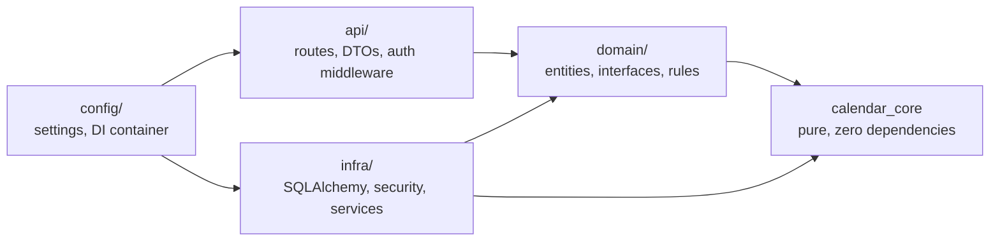
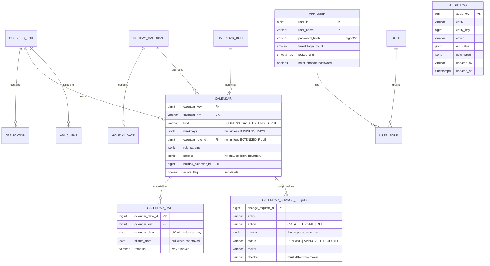
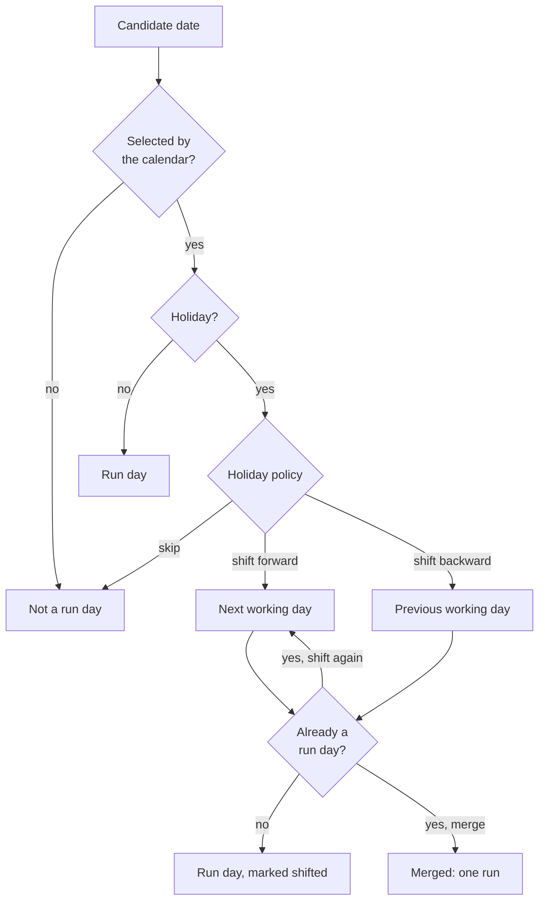
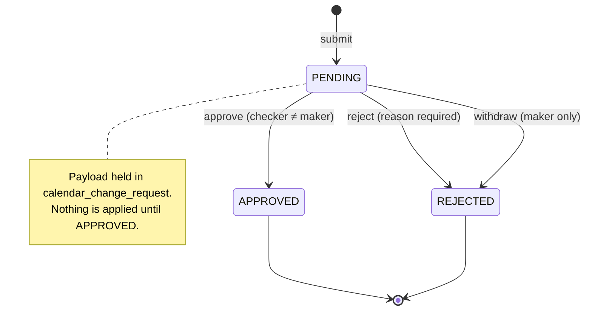
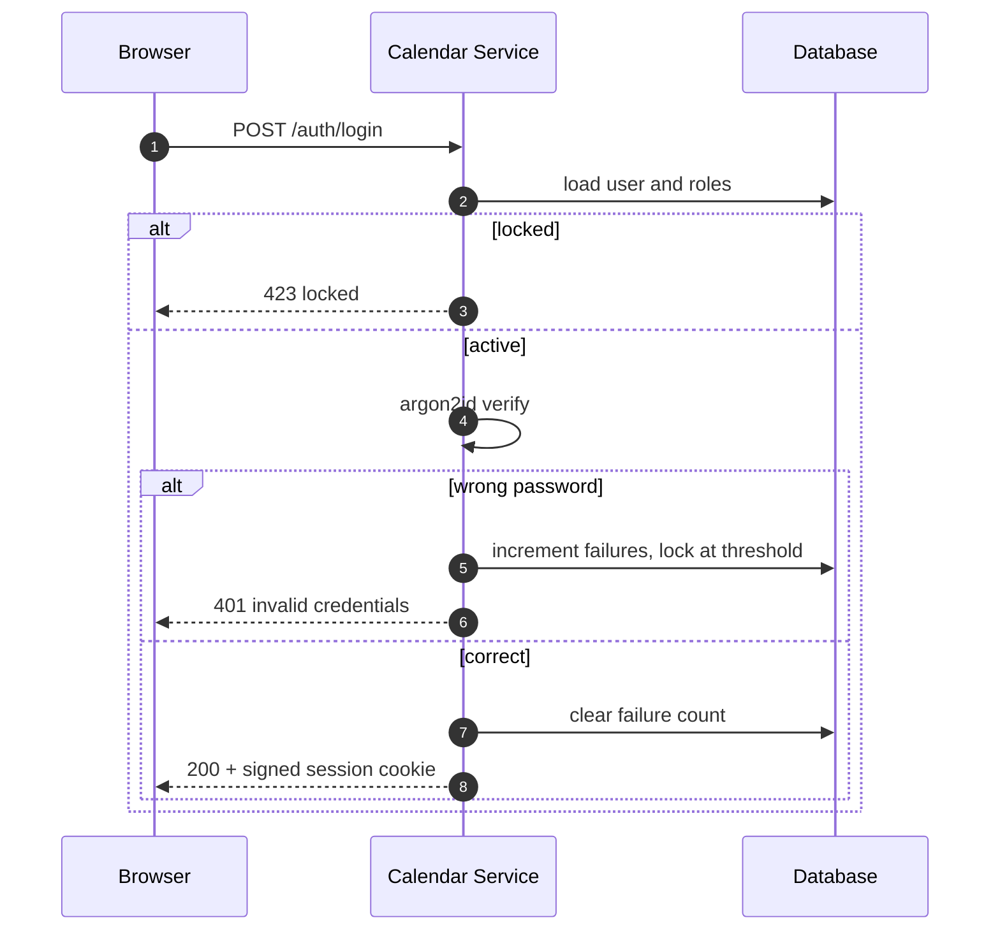

# Low Level Design

**Calendar Service and supporting packages**

| | |
|---|---|
| Version | 0.1 |
| Date | 2026-10-12 |
| Audience | Developers; reviewed alongside [hld.md](hld.md) |

Decision references (`D-xx`, `O-xx`, `R-xx`, `S-xx`) point at [RECORD.md](../../RECORD.md).

---

## 1. Code layout and dependency rule



**The rule:** `domain/` must never import from `api/` or `infra/`. Interfaces are declared in
`domain/`, implemented in `infra/`, wired in `config/dependency.py`. Ruff enforces this at the
repository root via banned-import rules.

---

## 2. Data model



### 2.1 Corrections to the requirements schema

The schema in the requirements document had defects that would have failed at deployment. All are
fixed; listed here so the change is visible to reviewers.

| ID | Original | Now |
|---|---|---|
| S-01/S-03 | Foreign keys declared on columns that were never defined | Columns declared |
| S-02 | `Big Interger` | `BigInteger`, with an `Integer` variant for SQLite |
| S-04/S-05 | No uniqueness or index on calendar dates | `UNIQUE(calendar_key, calendar_date)` plus a lookup index |
| S-06 | No link from a calendar to its holiday calendar | FK retained even though this phase is single-region (D-08) |
| S-07/S-08 | `Extended_rules` malformed and duplicating `calendar_rule` | Single `calendar_rule` table |
| S-10 | `TIMESTAMP` | `TIMESTAMPTZ` throughout |
| S-11 | Audit values as `BLOB` | `JSONB`, so the audit trail is queryable |
| S-12 | `BU_ID` / `App_ID` referenced with no tables | `business_unit` and `application` exist |
| S-13 | No way to hold an unapplied change | `calendar_change_request` from the first migration |

### 2.2 Constraints that carry business meaning

```sql
-- Business days and extended rules cannot coexist (O-08)
CHECK ((kind = 'BUSINESS_DAYS' AND weekdays IS NOT NULL AND calendar_rule_id IS NULL)
    OR (kind = 'EXTENDED_RULE' AND calendar_rule_id IS NOT NULL AND weekdays IS NULL))

-- Four-eyes cannot be satisfied by one person (11.4)
CHECK (checker IS NULL OR checker <> maker)
```

The second constraint caught a real defect during development: with the approval gate disabled the
service was recording the maker as their own approver, which would have produced an audit trail
showing every change approved by the person who made it.

### 2.3 Portability

Development runs on SQLite, deployment on PostgreSQL. Two dialect differences are handled
explicitly:

- Primary keys use `BigInteger().with_variant(Integer, "sqlite")`, because SQLite only
  autoincrements `INTEGER PRIMARY KEY`.
- JSON columns use `none_as_null=True`, otherwise Python `None` is stored as JSON `null` and the
  mutual-exclusivity constraint silently fails.
- Timestamps are normalised to UTC when read, because SQLite returns naive values.

A test asserts the Alembic head matches the models, so `create_all` and migrations cannot drift.

---

## 3. Rule engine

### 3.1 Contract

```python
generate_year(spec: CalendarSpec, year: int, holidays: Iterable[Holiday]) -> list[GeneratedDate]
```

Pure. No clock reads, no I/O. `GeneratedDate` carries `day`, `shifted_from` and `reason`, so the
UI and the audit trail can explain *why* a date moved.

### 3.2 Resolution algorithm



Two passes, in this order:

1. Claim every natural (non-holiday) run day.
2. Resolve holiday-affected days around them.

The order matters. Processing dates in calendar order allowed a shifted Monday to claim Tuesday's
slot *before* Tuesday was reached, after which Tuesday was dropped as a duplicate — producing one
run where two were intended, with plausible-looking output.

### 3.3 Undecided semantics, made explicit

Each is a policy enum with a proposed default, not a hidden assumption.

| Policy | Values | Default | Question |
|---|---|---|---|
| `HolidayPolicy` | `shift_forward`, `shift_backward`, `skip` | `shift_forward` | — |
| `CollisionPolicy` | `merge`, `shift_again` | `merge` | **O-06** |
| `BoundaryPolicy` | `clamp`, `allow_overflow` | `clamp` | **O-07** |

**Measured consequence of the defaults** (2027, Mon–Fri, three holidays):

| Collision | Holiday | Run days | Shifted |
|---|---|---:|---:|
| merge | shift_forward | 258 | 0 |
| merge | skip | 258 | 0 |
| shift_again | shift_forward | 261 | 3 |

The first two rows are identical: under the defaults, "shift the run" and "drop the run" produce
the same calendar, because the next working day is already a run day. The requirement's example
only has observable meaning for sparse calendars such as Mondays-only.

### 3.4 Rule registry

```python
@register("LAST_BUSINESS_DAY", "Last working day of each month")
def last_business_day(spec, year, holidays, policies) -> list[GeneratedDate]: ...
```

Fidelity supplies the authoritative rule list (D-09, O-28). Until it arrives, five provisional
rules are implemented: `WEEKEND_EXCLUSION`, `FIRST_BUSINESS_DAY`, `LAST_BUSINESS_DAY`,
`QUARTER_END`, `DAY_OF_MONTH`.

**A rule row in the database with no registered evaluator does nothing.** Both are required, which
is why seeding currently derives from the registry.

---

## 4. API surface

### 4.1 Human API — `/api/ui`, session authentication

| Method | Path | Role | Notes |
|---|---|---|---|
| POST | `/auth/login` | — | Identical response for unknown user and wrong password |
| POST | `/auth/logout` | any | 204 |
| GET | `/auth/me` | any | Current identity and roles |
| POST | `/auth/password` | any | Ends the session on success |
| GET | `/preview/rules` | **public** | Rule catalogue (O-32) |
| POST | `/preview` | **public** | Stateless computation, no persistence (O-32) |
| GET | `/calendars` | any | `include_inactive` optional |
| GET | `/calendars/{key}` | any | |
| GET | `/calendars/{key}/dates` | any | Filter by `year` |
| GET | `/calendars/{key}/history` | any | Audit trail |
| POST | `/calendars` | CREATE | `201` applied, `202` pending approval |
| PUT | `/calendars/{key}` | CREATE | `200` applied, `202` pending |
| DELETE | `/calendars/{key}` | CREATE | Soft delete |
| POST | `/calendars/{key}/materialise` | CREATE | Regenerate dates for given years |
| GET | `/change-requests` | any | Pending queue |
| POST | `/change-requests/{id}/approve` | APPROVER | `403` on self-approval |
| POST | `/change-requests/{id}/reject` | APPROVER | Reason required |

ADMIN satisfies every role guard.

### 4.2 Machine API — `/api/v1`, API key authentication

**Not yet built.** Shape depends on D-06 and O-09: a `Timetable` needs next-run information, not a
bare date. Separated physically from `/api/ui` with its own middleware so the later move to mTLS
or OAuth is a single-file change.

### 4.3 Status code conventions

| Code | Meaning here |
|---|---|
| 201 / 202 | Change applied / change raised and awaiting approval |
| 401 | Not authenticated, or session expired or idle |
| 403 | Authenticated but lacking the role, **or** attempting self-approval |
| 404 | Unknown calendar, change request, or unregistered rule |
| 409 | Duplicate calendar name, or a change request already resolved |
| 422 | Validation failure, including weak passwords |
| 423 | Account locked |

The contract is exported to [`docs/api/openapi.json`](../api/openapi.json) and committed; the web
client generates its types from that file.

---

## 5. Approval state machine



With `approval_required` off (D-10), the request is created `APPROVED` with **`checker` left
null** — a truthful record that no second pair of eyes was involved. Naming the maker as approver
would be a false audit record.

Every mutation goes through one `_submit` method, so enabling the gate changes one branch rather
than every call site.

---

## 6. Authentication detail



- Unknown users still run a hash, so a missing account is not distinguishable by timing.
- Lockout: configurable threshold, then a timed lock.
- Session carries `issued_at` and `last_seen`; both absolute and idle timeouts are enforced.
- Password change destroys the session, invalidating other sessions using the old credential.

**Outstanding:** breached-password checking, and the reset flow (O-01) — an Admin-performed reset
lets that Admin impersonate an Approver, which weakens four-eyes.

---

## 7. Materialisation and the rollover

```python
generate_year(spec, year, holidays) -> replace_dates(calendar_key, year, dates)
```

`replace_dates` deletes and reinserts within the year window only, so regenerating one year never
disturbs another. This makes the job idempotent, which matters for an operation that Fidelity will
run unattended.

### Coverage check

```
days_ahead = max(calendar_date) - today
ok         = days_ahead >= min_days_ahead
exit code  = 1 if any calendar is short
```

`today` is a parameter, not a clock read, so the behaviour at the cliff is testable.

```
as at 2027-11-01   US_Business_Days  last=2027-12-31  days_ahead=60   SHORT  exit=1
after generate_year --year 2028      last=2028-12-29  days_ahead=424  ok     exit=0
```

---

## 8. Airflow plugin internals (planned)

| Module | Responsibility |
|---|---|
| `plugin.py` | `AirflowPlugin` registration — the only way a custom timetable reaches Airflow |
| `timetable.py` | `next_dagrun_info`, `infer_manual_data_interval`, `serialize`/`deserialize` |
| `client.py` | `httpx` client, API key header, timeouts, retries |
| `cache.py` | Local snapshot reader; the only source `timetable.py` may read |
| `selfcheck.py` | Operator CLI proving connectivity, auth and cache freshness |

**Constraints.** `httpx` only, since it installs into environments we cannot inspect. Must not
import `calendar_core` or anything under `apps/`. Airflow serialises DAGs, so the timetable may
carry only JSON-serialisable state — the calendar name, nothing more.

**Blocked on O-19:** timetable APIs and DAG parsing differ materially between Airflow 2 and 3.

---

## 9. Configuration

| Variable | Default | Notes |
|---|---|---|
| `CALENDAR_DB_URL` | SQLite file | PostgreSQL in deployment |
| `CALENDAR_APPROVAL_REQUIRED` | `false` | The four-eyes gate (D-10) |
| `CALENDAR_SESSION_SECRET` | empty | **Must be set before deployment** (O-33) |
| `CALENDAR_SESSION_IDLE_MINUTES` | 30 | |
| `CALENDAR_SESSION_ABSOLUTE_MINUTES` | 480 | |
| `CALENDAR_SESSION_COOKIE_SECURE` | `true` | `false` only for local http |
| `CALENDAR_PASSWORD_MIN_LENGTH` | 12 | No composition rules by design |
| `CALENDAR_LOCKOUT_THRESHOLD` | 5 | |
| `CALENDAR_AUTO_CREATE_SCHEMA` | `true` | Development only; deployment uses Alembic |

---

## 10. Operational CLIs

```powershell
python -m calendar_service.jobs.bootstrap --admin-user first.admin --admin-email a@b.com
python -m calendar_service.jobs.load_holidays holidays.csv --calendar DEFAULT
python -m calendar_service.jobs.generate_year --year 2028
python -m calendar_service.jobs.check_coverage --min-days-ahead 90
```

All are idempotent. `bootstrap` prints a generated admin password once and never stores it in
clear. These are handover deliverables (D-05), so they are written for someone who has never seen
the codebase.

---

## 11. Testing strategy

| Layer | Approach | Count |
|---|---|---|
| Rule engine | Table-driven, including leap years, consecutive holidays, year boundaries | 47 |
| API | In-process ASGI client against SQLite, real dependency graph | 47 |
| Jobs | Direct invocation with an injected session and date | 9 |
| Migration | Alembic head compared against model metadata | included |

Not covered: a real PostgreSQL integration run, frontend tests, and any end-to-end test through
Airflow — the last is impossible by delivery boundary (R-10).
