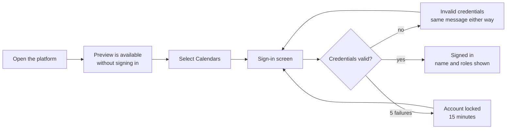
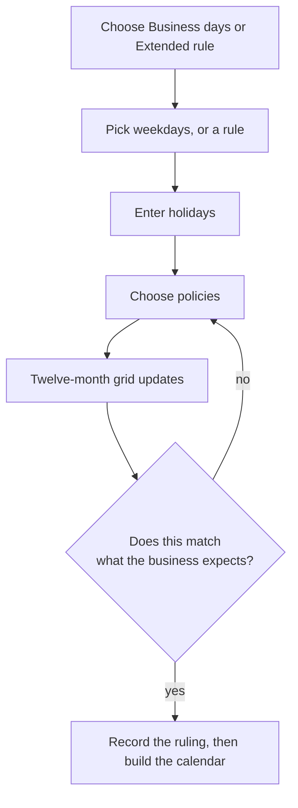
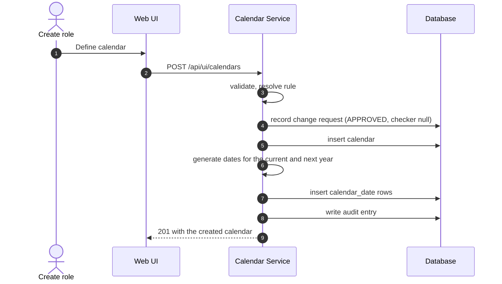
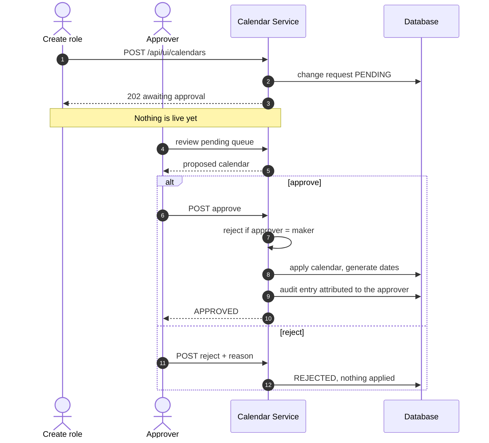
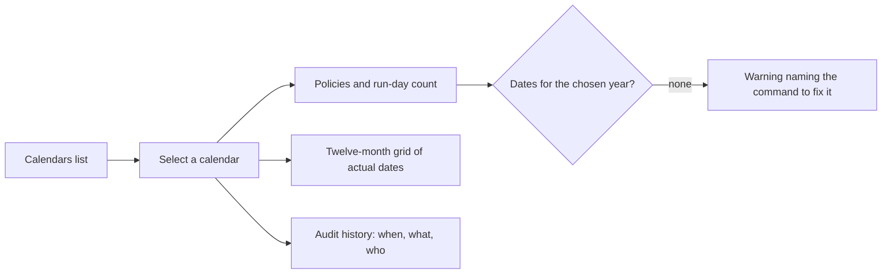
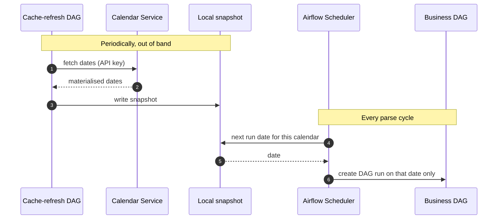
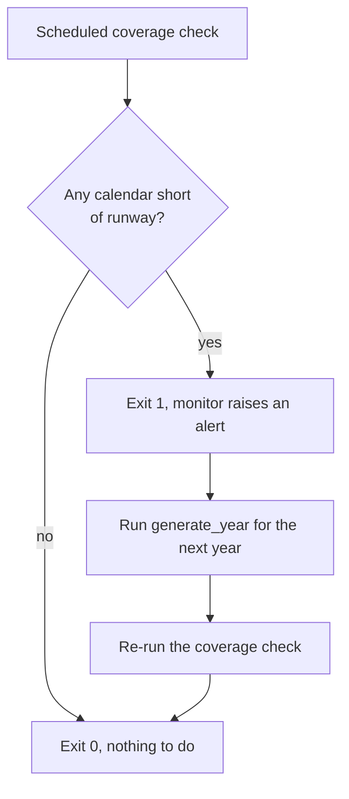
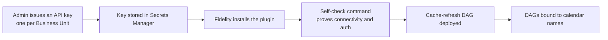
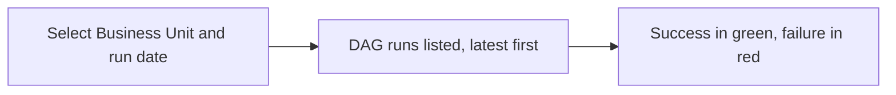

# User Flows

Journeys through the platform, written for client walkthrough. Each flow states who performs it,
what they see, and what the system does behind the scenes.

Companion documents: [hld.md](hld.md) · [lld.md](lld.md) · [RECORD.md](../../RECORD.md)

**Legend** — ✅ built and testable · 🕐 planned · ⛔ blocked on a client decision

---

## Roles

| Role | Can do | Cannot do |
|---|---|---|
| **Viewer** | View calendars, dates, audit history | Change anything |
| **Create** | Create, update, delete calendars | Approve their own or anyone's change |
| **Approver** | Approve or reject pending changes | Create or edit calendars |
| **Admin** | Everything above | — (see note) |

> **Note for discussion.** Admin holds both create and approve rights, so an Admin can approve
> their own change. That weakens four-eyes. The system blocks self-approval **by identity**, so
> even a user holding both roles cannot approve their own change — but an Admin can still approve
> a colleague's change they effectively authored. Confirm whether this is acceptable (O-30).

---

## Flow 1 — Signing in ✅



**What the user sees:** a sign-in form stating that single sign-on is out of scope for this phase.
After signing in, their user name and roles appear in the header with a sign-out button.

**Worth noting for the client:** a wrong password and an unknown user return exactly the same
message, so the form cannot be used to discover valid user names.

---

## Flow 2 — Preview before committing ✅

**Who:** anyone, including before signing in. **Why it exists:** it turns an argument about wording
into a look at output.



The grid colours each day: **green** a scheduled run, **amber** a run that moved, **rose** a
holiday or a date a run moved away from. Hovering any date explains why it moved.

### The question this screen is designed to answer

Set a Monday-to-Friday calendar for 2027 with three holidays, then change the collision policy:

| Collision | Holiday policy | Run days | Shifted |
|---|---|---:|---:|
| Merge | Shift forward | 258 | 0 |
| Merge | Skip the run | 258 | 0 |
| Shift again | Shift forward | 261 | 3 |

The first two rows produce an **identical calendar**. Under the proposed defaults, "move the run
to the next working day" and "drop the run" are indistinguishable, because the next working day is
already a run day.

**Ask the client:** on a Monday-to-Friday calendar, when a holiday falls on a working day, should
the year's run count fall by one, or should the run be preserved on an extra day? (**O-06**)

---

## Flow 3 — Creating a calendar

### 3a. Approval gate off ✅ (current default)



The change request is still written, with **no checker recorded** — an honest statement that no
second person reviewed it.

### 3b. Approval gate on ⛔ (blocked on S-13)



**Why this is blocked.** The requirements name an Approver role but never define what is approved:
the calendar definition, the generated dates, or both. Until that is settled the editing screens
cannot be designed. The database table and the state machine exist, so answering **S-13** is a
configuration change rather than a rebuild.

---

## Flow 4 — Reviewing a calendar ✅

**Who:** any signed-in user.



The empty state is deliberately loud. The production failure mode is silence, so a calendar with
no dates for a year says so explicitly rather than rendering an empty grid that looks plausible.

**For audit discussion:** the history shows the actor for every change. Where a change went
through approval, it is attributed to the **approver**, because that is the person who authorised
it taking effect.

---

## Flow 5 — A DAG running on a calendar ⛔ (blocked on O-19)

**Who:** nobody. This is automatic, and it is the point of the whole platform.



A DAG is bound to a calendar **once**, in its definition:

```python
with DAG(dag_id="eod_positions", schedule=CalendarTimetable("US_Business_Days")):
```

From then on, changing the calendar in the UI changes when that DAG runs — no code change, no
redeploy. This is the AutoSys-like behaviour the requirement describes.

**Two things to be clear about with the client:**

1. A timetable cannot be created or changed *while a DAG is running*. The binding is set at
   definition time; the calendar behind it is what changes.
2. The scheduler reads a **local cache**, not our API. That keeps DAGs scheduling correctly
   through a Calendar Service outage, instead of stalling the scheduler.

---

## Flow 6 — The annual rollover ✅ (runbook outstanding)

**Who:** Fidelity operations, after our engagement ends (D-05).



```
as at 2027-11-01   US_Business_Days  last=2027-12-31  days_ahead=60   SHORT  exit=1
after generate_year --year 2028      last=2028-12-29  days_ahead=424  ok     exit=0
```

### Why this flow matters more than it looks

Dates are generated for 2026 and 2027 only. On 1 January 2028, without a rollover, **every
calendar returns nothing and every bound DAG silently stops firing** — no error, no failed task,
no alert.

The engagement ends before that date. So the deliverable is not only the script but the runbook,
the scheduled coverage check, and a named owner at Fidelity (O-04, R-06, R-07).

---

## Flow 7 — Onboarding a new environment 🕐



The self-check exists so a Business Unit can diagnose its own installation without us. Under the
plugin-only delivery boundary (D-07), "DAGs are not firing" could be our package or their wiring,
and without diagnostics that investigation lands on us by default (R-09).

Keys are per Business Unit so one can be revoked without a system-wide outage, and two keys can be
active at once for zero-downtime rotation.

---

## Flow 8 — Viewing DAG runs across Business Units ⛔ (blocked on O-13)



Defaults: all Business Units when none is chosen, today when no date is given. View only.

**The decision to take first.** Metadata arrives by fire-and-forget Airflow listeners with no
queue, retry or dead-letter path, and daily reconciliation is explicitly out of scope. Together
those mean any dropped event is **permanently and undetectably lost**, so the view cannot be
guaranteed accurate.

If anyone downstream will treat this dashboard as authoritative, an outbox or queue is needed. It
is inexpensive now and expensive to retrofit.

---

## Summary of what to confirm

| Flow | Question | ID |
|---|---|---|
| 2 | Holiday on a Mon–Fri calendar: lose a run, or move it to an extra day? | O-06 |
| 3 | What exactly does a four-eyes approval approve? | S-13 |
| 3 | May one person hold both Create and Approver? | O-30 |
| 5 | Which Airflow version is in each Business Unit? | O-19 |
| 6 | Who owns the annual rollover after handover? | R-07 |
| 8 | Must DAG-run metadata delivery be guaranteed? | O-13 |
| — | How many distinct extended rules exist in AutoSys today? | O-28 |
