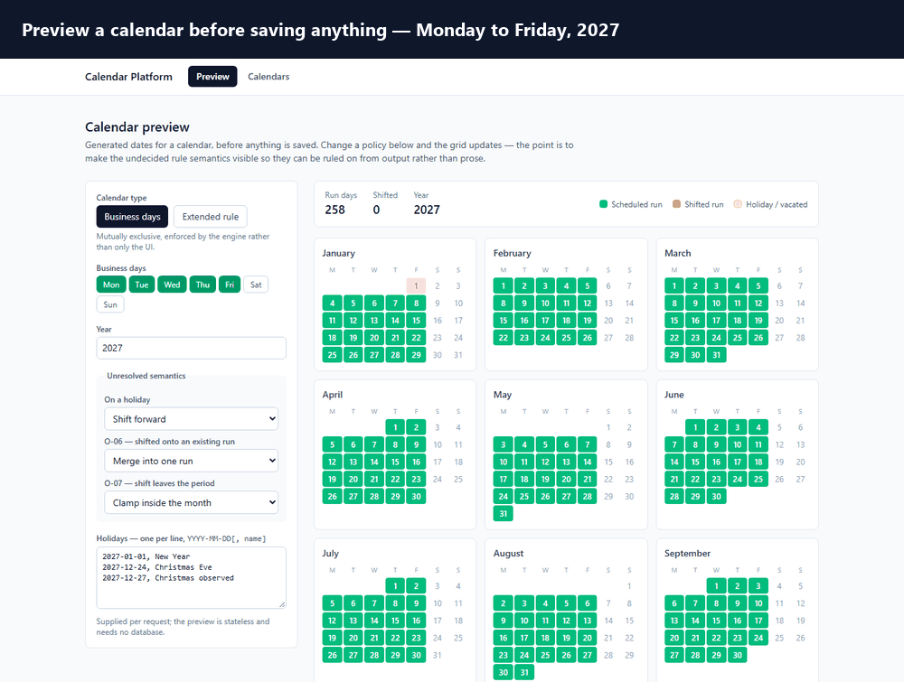

# Demo walkthrough



Nine captioned frames, roughly 21 seconds, 0.7 MB. Recorded against the running application with
demo data — four calendars and the US 2027 holiday list — not a mock-up.

| Frame | Shows |
|---|---|
| 1 | Preview, Monday to Friday 2027 — **258 run days, 0 shifted** |
| 2 | The same calendar with the opposite collision rule — **identical output** (O-06) |
| 3 | Mondays only: amber runs moved off a holiday, rose dates they left |
| 4 | Extended rule, last working day of each month |
| 5 | Sign-in — calendars require an account, preview does not |
| 6 | Calendars list, signed in as ADMIN |
| 7 | Calendar detail: 52 runs, 5 shifted, with the month grid |
| 8 | Audit history — what changed, when, and by whom |
| 9 | A year with no dates: the cliff is called out, not failed silently |

Frames 1 and 2 are the pair worth pausing on. Same calendar, same holidays, opposite answers to
the open question O-06, and the generated calendar does not change — because a Monday-to-Friday
calendar has no free weekday to move a run onto. See [RECORD.md](../../RECORD.md) section 12.4.

## Re-recording

Needs the app running locally, with the session cookie relaxed for plain http:

```powershell
$env:CALENDAR_DB_URL = "sqlite+aiosqlite:///./demo.db"
$env:CALENDAR_SESSION_COOKIE_SECURE = "false"

.\.venv\Scripts\python.exe -m calendar_service.jobs.bootstrap --admin-user a.patodi --admin-email you@example.com --holiday-calendar US --region US
.\.venv\Scripts\python.exe -m calendar_service.jobs.load_holidays us-holidays-2027.csv --calendar US
.\.venv\Scripts\python.exe -m uvicorn calendar_service.main:app --port 8000
npm run dev --prefix apps/web
```

Then, with the calendars created and 2027 materialised:

```powershell
.\.venv\Scripts\python.exe docs/demo/record_demo.py --password "<admin password>"
```

Useful flags: `--headed` to watch it drive the browser, `--keep-frames` to inspect the individual
PNGs before they are assembled.

## Notes on the recorder

[record_demo.py](record_demo.py) captures viewport-sized frames rather than full-page ones, so the
result reads like a screen recording instead of a scrolling document. Each step declares its own
caption, display duration and scroll position, because uniform timing makes every frame feel
either rushed or sluggish.

Assembly uses `imageio`, not PIL: PIL's GIF encoder merges visually similar frames, which quietly
drops steps from the animation.

Requires `playwright`, `Pillow`, `imageio` and `numpy`, plus `python -m playwright install
chromium`.
